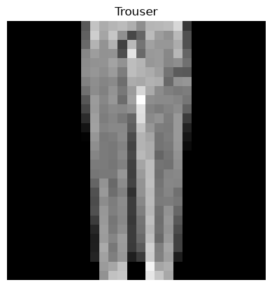
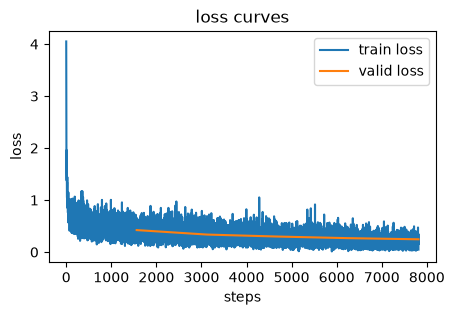

# core


<!-- WARNING: THIS FILE WAS AUTOGENERATED! DO NOT EDIT! -->

``` python
import torch
from torchvision import datasets, transforms
import matplotlib as mpl
from lucidlearn.nn import make_conv2d, make_layernorm2d, make_squeeze, make_linear
random_key = random.key(42)
```

## Small Helpers

------------------------------------------------------------------------

<a
href="https://github.com/frenio/lucidlearn/blob/main/lucidlearn/core.py#L32"
target="_blank" style="float:right; font-size:smaller">source</a>

### list_layers

``` python
def list_layers(
    params
):
```

------------------------------------------------------------------------

<a
href="https://github.com/frenio/lucidlearn/blob/main/lucidlearn/core.py#L28"
target="_blank" style="float:right; font-size:smaller">source</a>

### n_parameters

``` python
def n_parameters(
    params
):
```

## Visualization Functions

``` python
def chunks(x, sz):
  for i in range(0, len(x), sz): yield x[i:i+sz]

def show_data(fashion_image, label=None, is_1d=False):
    if isinstance(fashion_image, tuple):
        fig, ax = plt.subplots(1, len(fashion_image), figsize=(9, 3))
        for i, x in enumerate(fashion_image):
            ax[i].imshow(x)
            ax[i].axis('off');
        plt.show()
    else:
        mpl.rcParams['image.cmap'] = 'gray'
        if label is not None:
            plt.title(f"{idx_to_class[label.item()]}")
        if is_1d==True:
            plt.imshow(list(chunks(fashion_image, 28)));
        else:
            plt.imshow(fashion_image);
        plt.axis('off');
```

## Load Fashion-MNIST

``` python
train_data = datasets.FashionMNIST(root="./data", train=True, download=True, transform=transforms.ToTensor())
test_data = datasets.FashionMNIST(root="./data", train=False, download=True, transform=transforms.ToTensor())
x_train_all = train_data.data[:, None, :, :]/255
y_train_all = train_data.targets

rand_idx = torch.randperm(x_train_all.shape[0])
x_train = x_train_all[rand_idx[:50_000]]
train_mean = x_train.mean()
train_std = x_train.std()

x_train = jnp.array((x_train - train_mean) / train_std)
y_train = jnp.array(y_train_all[rand_idx[:50_000]])
x_valid = jnp.array((x_train_all[rand_idx[50_000:]] - train_mean) / train_std)
y_valid = jnp.array(y_train_all[rand_idx[50_000:]])
x_test = jnp.array((test_data.data[:, None, :, :]/255 - train_mean) / train_std)
y_test = jnp.array(test_data.targets)

x_train.shape, y_train.shape, x_valid.shape, y_valid.shape, x_test.shape, y_test.shape,
```

    ((50000, 1, 28, 28),
     (50000,),
     (10000, 1, 28, 28),
     (10000,),
     (10000, 1, 28, 28),
     (10000,))

``` python
idx_to_class = {value: key for key, value in train_data.class_to_idx.items()}
num_classes = len(idx_to_class)
idx_to_class, num_classes
```

    ({0: 'T-shirt/top',
      1: 'Trouser',
      2: 'Pullover',
      3: 'Dress',
      4: 'Coat',
      5: 'Sandal',
      6: 'Shirt',
      7: 'Sneaker',
      8: 'Bag',
      9: 'Ankle boot'},
     10)

## DataLoaders

------------------------------------------------------------------------

<a
href="https://github.com/frenio/lucidlearn/blob/main/lucidlearn/core.py#L38"
target="_blank" style="float:right; font-size:smaller">source</a>

### Dataset

``` python
def Dataset(
    x, y
):
```

*Combines features and lables in a dataset.*

``` python
train_ds = Dataset(x_train, y_train)
valid_ds = Dataset(x_valid, y_valid)
test_ds = Dataset(x_test, y_test)
```

``` python
show_data(x_train[0].squeeze(), y_train[0])
```



------------------------------------------------------------------------

<a
href="https://github.com/frenio/lucidlearn/blob/main/lucidlearn/core.py#L45"
target="_blank" style="float:right; font-size:smaller">source</a>

### DataLoader

``` python
def DataLoader(
    dataset, batch_size:int=32, drop_last:bool=False, shuffle:bool=True, random_key:NoneType=None
):
```

*Returns iterable batches from a dataset*

``` python
test_train_ds = Dataset(x_train[:-1], y_train[:-1])
```

``` python
test_dataloader = DataLoader(test_train_ds, batch_size = 2)
test_generator = iter(test_dataloader)
next(test_generator)
```

    (Array([[[[-0.8102359 , -0.8102359 , -0.8102359 , ..., -0.8102359 ,
               -0.8102359 , -0.8102359 ],
              [-0.8102359 , -0.8102359 , -0.8102359 , ..., -0.8102359 ,
               -0.8102359 , -0.8102359 ],
              [-0.8102359 , -0.8102359 , -0.8102359 , ..., -0.8102359 ,
               -0.8102359 , -0.8102359 ],
              ...,
              [-0.8102359 , -0.8102359 , -0.8102359 , ..., -0.8102359 ,
               -0.8102359 , -0.8102359 ],
              [-0.8102359 , -0.8102359 , -0.8102359 , ..., -0.8102359 ,
               -0.8102359 , -0.8102359 ],
              [-0.8102359 , -0.8102359 , -0.8102359 , ..., -0.8102359 ,
               -0.8102359 , -0.8102359 ]]],
     
     
            [[[-0.8102359 , -0.8102359 , -0.8102359 , ..., -0.8102359 ,
               -0.8102359 , -0.8102359 ],
              [-0.8102359 , -0.8102359 , -0.8102359 , ..., -0.8102359 ,
               -0.8102359 , -0.8102359 ],
              [-0.8102359 , -0.8102359 , -0.8102359 , ..., -0.8102359 ,
               -0.8102359 , -0.8102359 ],
              ...,
              [-0.8102359 , -0.8102359 , -0.8102359 , ..., -0.01067519,
               -0.8102359 , -0.8102359 ],
              [-0.8102359 , -0.8102359 , -0.8102359 , ..., -0.8102359 ,
               -0.8102359 , -0.8102359 ],
              [-0.8102359 , -0.8102359 , -0.8102359 , ..., -0.8102359 ,
               -0.8102359 , -0.8102359 ]]]], dtype=float32),
     Array([8, 5], dtype=int32))

``` python
len(test_dataloader)
```

    25000

``` python
test_dataloader = DataLoader(test_train_ds, batch_size = 2, drop_last=True)
test_generator = iter(test_dataloader)
next(test_generator)
```

    (Array([[[[-0.8102359 , -0.8102359 , -0.8102359 , ..., -0.8102359 ,
               -0.8102359 , -0.8102359 ],
              [-0.8102359 , -0.8102359 , -0.8102359 , ..., -0.8102359 ,
               -0.8102359 , -0.8102359 ],
              [-0.8102359 , -0.8102359 , -0.8102359 , ..., -0.8102359 ,
               -0.8102359 , -0.8102359 ],
              ...,
              [-0.8102359 , -0.8102359 , -0.8102359 , ..., -0.8102359 ,
               -0.8102359 , -0.8102359 ],
              [-0.8102359 , -0.8102359 , -0.8102359 , ..., -0.8102359 ,
               -0.8102359 , -0.8102359 ],
              [-0.8102359 , -0.8102359 , -0.8102359 , ..., -0.8102359 ,
               -0.8102359 , -0.8102359 ]]],
     
     
            [[[-0.8102359 , -0.8102359 , -0.8102359 , ..., -0.8102359 ,
               -0.8102359 , -0.8102359 ],
              [-0.8102359 , -0.8102359 , -0.8102359 , ..., -0.8102359 ,
               -0.8102359 , -0.8102359 ],
              [-0.8102359 , -0.8102359 , -0.8102359 , ..., -0.8102359 ,
               -0.8102359 , -0.8102359 ],
              ...,
              [-0.8102359 , -0.8102359 , -0.8102359 , ..., -0.01067519,
               -0.8102359 , -0.8102359 ],
              [-0.8102359 , -0.8102359 , -0.8102359 , ..., -0.8102359 ,
               -0.8102359 , -0.8102359 ],
              [-0.8102359 , -0.8102359 , -0.8102359 , ..., -0.8102359 ,
               -0.8102359 , -0.8102359 ]]]], dtype=float32),
     Array([8, 5], dtype=int32))

``` python
len(test_dataloader)
```

    24999

``` python
bs = 32

train_dl = DataLoader(train_ds, batch_size=bs, shuffle=True)
valid_dl = DataLoader(valid_ds, batch_size=bs, shuffle=True)
test_dl = DataLoader(test_ds, batch_size=bs, shuffle=False)
```

------------------------------------------------------------------------

<a
href="https://github.com/frenio/lucidlearn/blob/main/lucidlearn/core.py#L81"
target="_blank" style="float:right; font-size:smaller">source</a>

### DataLoaders

``` python
def DataLoaders(
    *dls
):
```

*Combines training and validation data in a DataLoaders object that can
be passed to a learner.*

``` python
dls = DataLoaders(train_dl, valid_dl)
dls.train, dls.valid
```

    (<__main__.DataLoader>,
     <__main__.DataLoader>)

``` python
one_batch = next(iter(dls.train))[0]
one_batch.shape
```

    (32, 1, 28, 28)

## Learner and Callbacks

------------------------------------------------------------------------

<a
href="https://github.com/frenio/lucidlearn/blob/main/lucidlearn/core.py#L88"
target="_blank" style="float:right; font-size:smaller">source</a>

### CancelEpochException

``` python
def CancelEpochException(
    *args, **kwargs
):
```

*Common base class for all non-exit exceptions.*

------------------------------------------------------------------------

<a
href="https://github.com/frenio/lucidlearn/blob/main/lucidlearn/core.py#L87"
target="_blank" style="float:right; font-size:smaller">source</a>

### CancelBatchException

``` python
def CancelBatchException(
    *args, **kwargs
):
```

*Common base class for all non-exit exceptions.*

------------------------------------------------------------------------

<a
href="https://github.com/frenio/lucidlearn/blob/main/lucidlearn/core.py#L86"
target="_blank" style="float:right; font-size:smaller">source</a>

### CancelFitException

``` python
def CancelFitException(
    *args, **kwargs
):
```

*Common base class for all non-exit exceptions.*

------------------------------------------------------------------------

<a
href="https://github.com/frenio/lucidlearn/blob/main/lucidlearn/core.py#L91"
target="_blank" style="float:right; font-size:smaller">source</a>

### with_cbs

``` python
def with_cbs(
    nm
):
```

------------------------------------------------------------------------

<a
href="https://github.com/frenio/lucidlearn/blob/main/lucidlearn/core.py#L104"
target="_blank" style="float:right; font-size:smaller">source</a>

### run_cbs

``` python
def run_cbs(
    cbs, method_nm, learn:NoneType=None
):
```

------------------------------------------------------------------------

<a
href="https://github.com/frenio/lucidlearn/blob/main/lucidlearn/core.py#L113"
target="_blank" style="float:right; font-size:smaller">source</a>

### Learner

``` python
def Learner(
    model, params, dls:tuple=(0,), loss_func:function=softmax_cross_entropy_with_integer_labels, lr:float=0.001,
    cbs:NoneType=None, opt:function=sgd, random_key:NoneType=None
):
```

------------------------------------------------------------------------

<a
href="https://github.com/frenio/lucidlearn/blob/main/lucidlearn/core.py#L190"
target="_blank" style="float:right; font-size:smaller">source</a>

### Callback

``` python
def Callback(
    *args, **kwargs
):
```

------------------------------------------------------------------------

<a
href="https://github.com/frenio/lucidlearn/blob/main/lucidlearn/core.py#L193"
target="_blank" style="float:right; font-size:smaller">source</a>

### DeviceParallelCB

``` python
def DeviceParallelCB(
    preload_data:bool=False
):
```

------------------------------------------------------------------------

<a
href="https://github.com/frenio/lucidlearn/blob/main/lucidlearn/core.py#L213"
target="_blank" style="float:right; font-size:smaller">source</a>

### MetricsCB

``` python
def MetricsCB(
    *ms, **metrics
):
```

------------------------------------------------------------------------

<a
href="https://github.com/frenio/lucidlearn/blob/main/lucidlearn/core.py#L261"
target="_blank" style="float:right; font-size:smaller">source</a>

### OneCycleCB

``` python
def OneCycleCB(
    pct_start:float=0.3, div:int=25, final_div:float=10000.0
):
```

------------------------------------------------------------------------

<a
href="https://github.com/frenio/lucidlearn/blob/main/lucidlearn/core.py#L288"
target="_blank" style="float:right; font-size:smaller">source</a>

### LRRecorderCB

``` python
def LRRecorderCB():
```

------------------------------------------------------------------------

<a
href="https://github.com/frenio/lucidlearn/blob/main/lucidlearn/core.py#L307"
target="_blank" style="float:right; font-size:smaller">source</a>

### LossRecorderCB

``` python
def LossRecorderCB():
```

------------------------------------------------------------------------

<a
href="https://github.com/frenio/lucidlearn/blob/main/lucidlearn/core.py#L339"
target="_blank" style="float:right; font-size:smaller">source</a>

### ProgressCB

``` python
def ProgressCB(
    n:int=50
):
```

------------------------------------------------------------------------

<a
href="https://github.com/frenio/lucidlearn/blob/main/lucidlearn/core.py#L359"
target="_blank" style="float:right; font-size:smaller">source</a>

### PredsCB

``` python
def PredsCB(
    *args, **kwargs
):
```

## Metrics

------------------------------------------------------------------------

<a
href="https://github.com/frenio/lucidlearn/blob/main/lucidlearn/core.py#L373"
target="_blank" style="float:right; font-size:smaller">source</a>

### cos_sim

``` python
def cos_sim(
    p, y
):
```

------------------------------------------------------------------------

<a
href="https://github.com/frenio/lucidlearn/blob/main/lucidlearn/core.py#L369"
target="_blank" style="float:right; font-size:smaller">source</a>

### accuracy

``` python
def accuracy(
    preds, targs
):
```

## Advanced Model Factory

------------------------------------------------------------------------

<a
href="https://github.com/frenio/lucidlearn/blob/main/lucidlearn/core.py#L378"
target="_blank" style="float:right; font-size:smaller">source</a>

### split_key

``` python
def split_key(
    key, n
):
```

*Split `key` into `n` keys, or return `n` Nones in eval mode.*

------------------------------------------------------------------------

<a
href="https://github.com/frenio/lucidlearn/blob/main/lucidlearn/core.py#L387"
target="_blank" style="float:right; font-size:smaller">source</a>

### make_model

``` python
def make_model(
    key, model_dict, **defaults
):
```

*Compose `make_*` layers in `model_dict` into a single (params, fn)
pair.*

``` python
model_dict = {'Conv2d_1':    {'make_fn': make_conv2d,     'args': (8, 1),      'kwargs': {'strides': (2, 2), 'act': True}},
              'LayerNorm_1': {'make_fn': make_layernorm2d,  'args': (8,),         'kwargs': {'ndims': 4}},
              'Conv2d_2':    {'make_fn': make_conv2d,     'args': (16, 8),     'kwargs': {'strides': (2, 2), 'act': True}},
              'LayerNorm_2': {'make_fn': make_layernorm2d,  'args': (16,),         'kwargs': {'ndims': 4}},
              'Conv2d_3':    {'make_fn': make_conv2d,     'args': (32, 16),    'kwargs': {'padding': 'VALID', 'strides': (2, 2), 'act': True}},
              'LayerNorm_3': {'make_fn': make_layernorm2d,  'args': (32,),         'kwargs': {'ndims': 4}},
              'Conv2d_4':    {'make_fn': make_conv2d,     'args': (64, 32),    'kwargs': {'padding': 'VALID', 'strides': (1, 1), 'act': True}},
              'LayerNorm_4': {'make_fn': make_layernorm2d,  'args': (64,),         'kwargs': {'ndims': 4}},
              'Squeeze' :    {'make_fn': make_squeeze,    'args': (),          'kwargs': {'dims': (2, 3)}},
              'Linear_1':    {'make_fn': make_linear,     'args': (64, num_classes), 'kwargs': {'act': False}}}
```

``` python
params, model = make_model(random_key, model_dict)
```

``` python
n_parameters(params)
list_layers(params)
```

    Number of Model Parameters: 25274

    Model Layers:
    Conv2d_1
    LayerNorm_1
    Conv2d_2
    LayerNorm_2
    Conv2d_3
    LayerNorm_3
    Conv2d_4
    LayerNorm_4
    Squeeze
    Linear_1

``` python
model(params, one_batch).shape
```

    (32, 10)

## Training

``` python
dls = DataLoaders(train_dl, valid_dl)
params, model = make_model(random_key, model_dict)
metrics = MetricsCB(accuracy)
progress = ProgressCB()
lr_rec = LRRecorderCB()
loss_rec = LossRecorderCB()
cbs = [DeviceParallelCB(), OneCycleCB(), metrics, lr_rec, loss_rec, progress]
learn = Learner(model, params, dls, loss_func=optax.softmax_cross_entropy_with_integer_labels, lr=0.01, cbs=cbs, opt=optax.adamw)
```

``` python
print(metrics)
```

    accuracy

``` python
metrics
```

accuracy

``` python
learn.fit(5)
```

      train     0/1563 (   0%)      0s  loss=4.0507
      train    50/1563 (   3%)      1s  loss=0.7899
      train   100/1563 (   6%)      1s  loss=0.7520
      train   150/1563 (  10%)      1s  loss=0.5773
      train   200/1563 (  13%)      1s  loss=0.5539
      train   250/1563 (  16%)      2s  loss=0.6439
      train   300/1563 (  19%)      2s  loss=0.7934
      train   350/1563 (  22%)      2s  loss=0.5621
      train   400/1563 (  26%)      2s  loss=0.4673
      train   450/1563 (  29%)      2s  loss=0.4236
      train   500/1563 (  32%)      3s  loss=0.5838
      train   550/1563 (  35%)      3s  loss=0.6241
      train   600/1563 (  38%)      3s  loss=0.4254
      train   650/1563 (  42%)      3s  loss=0.5866
      train   700/1563 (  45%)      3s  loss=0.5117
      train   750/1563 (  48%)      4s  loss=0.3466
      train   800/1563 (  51%)      4s  loss=0.5461
      train   850/1563 (  54%)      4s  loss=0.6606
      train   900/1563 (  58%)      4s  loss=0.3345
      train   950/1563 (  61%)      4s  loss=0.2842
      train  1000/1563 (  64%)      5s  loss=0.4864
      train  1050/1563 (  67%)      5s  loss=0.2354
      train  1100/1563 (  70%)      5s  loss=0.6745
      train  1150/1563 (  74%)      5s  loss=0.4779
      train  1200/1563 (  77%)      6s  loss=0.4604
      train  1250/1563 (  80%)      6s  loss=0.5209
      train  1300/1563 (  83%)      6s  loss=0.3361
      train  1350/1563 (  86%)      6s  loss=0.2051
      train  1400/1563 (  90%)      6s  loss=0.1721
      train  1450/1563 (  93%)      7s  loss=0.4354
      train  1500/1563 (  96%)      7s  loss=0.3574
      train  1550/1563 (  99%)      7s  loss=0.5581
                                                                                                        
    Epoch       accuracy        loss    Mode
    ----------------------------------------
    0             0.8127      0.5232   train

      eval     0/313 (   0%)      0s  loss=0.3762
      eval    50/313 (  16%)      0s  loss=0.4760
      eval   100/313 (  32%)      0s  loss=0.4972
      eval   150/313 (  48%)      0s  loss=0.4830
      eval   200/313 (  64%)      1s  loss=0.5836
      eval   250/313 (  80%)      1s  loss=0.3962
      eval   300/313 (  96%)      1s  loss=0.2463
                                                                                                        
    0             0.8427      0.4228    eval

      train     0/1563 (   0%)      0s  loss=0.2772
      train    50/1563 (   3%)      0s  loss=0.4397
      train   100/1563 (   6%)      0s  loss=0.2985
      train   150/1563 (  10%)      1s  loss=0.6054
      train   200/1563 (  13%)      1s  loss=0.3769
      train   250/1563 (  16%)      1s  loss=0.3980
      train   300/1563 (  19%)      1s  loss=0.2722
      train   350/1563 (  22%)      1s  loss=0.2894
      train   400/1563 (  26%)      2s  loss=0.4151
      train   450/1563 (  29%)      2s  loss=0.2221
      train   500/1563 (  32%)      2s  loss=0.4011
      train   550/1563 (  35%)      2s  loss=0.3078
      train   600/1563 (  38%)      2s  loss=0.2434
      train   650/1563 (  42%)      3s  loss=0.2936
      train   700/1563 (  45%)      3s  loss=0.1496
      train   750/1563 (  48%)      3s  loss=0.5957
      train   800/1563 (  51%)      3s  loss=0.3572
      train   850/1563 (  54%)      4s  loss=0.2920
      train   900/1563 (  58%)      4s  loss=0.2983
      train   950/1563 (  61%)      4s  loss=0.4651
      train  1000/1563 (  64%)      4s  loss=0.5049
      train  1050/1563 (  67%)      4s  loss=0.3218
      train  1100/1563 (  70%)      5s  loss=0.5373
      train  1150/1563 (  74%)      5s  loss=0.3342
      train  1200/1563 (  77%)      5s  loss=0.2270
      train  1250/1563 (  80%)      5s  loss=0.6468
      train  1300/1563 (  83%)      5s  loss=0.2269
      train  1350/1563 (  86%)      6s  loss=0.3676
      train  1400/1563 (  90%)      6s  loss=0.5573
      train  1450/1563 (  93%)      6s  loss=0.2115
      train  1500/1563 (  96%)      6s  loss=0.3253
      train  1550/1563 (  99%)      6s  loss=0.3152
                                                                                                        
    1             0.8651      0.3659   train

      eval     0/313 (   0%)      0s  loss=0.3912
      eval    50/313 (  16%)      0s  loss=0.4002
      eval   100/313 (  32%)      0s  loss=0.3925
      eval   150/313 (  48%)      0s  loss=0.2623
      eval   200/313 (  64%)      0s  loss=0.5411
      eval   250/313 (  80%)      0s  loss=0.3389
      eval   300/313 (  96%)      1s  loss=0.1451
                                                                                                        
    1             0.8788      0.3366    eval

      train     0/1563 (   0%)      0s  loss=0.3479
      train    50/1563 (   3%)      0s  loss=0.5217
      train   100/1563 (   6%)      0s  loss=0.1162
      train   150/1563 (  10%)      1s  loss=0.2469
      train   200/1563 (  13%)      1s  loss=0.3976
      train   250/1563 (  16%)      1s  loss=0.1215
      train   300/1563 (  19%)      1s  loss=0.1921
      train   350/1563 (  22%)      1s  loss=0.2764
      train   400/1563 (  26%)      2s  loss=0.5716
      train   450/1563 (  29%)      2s  loss=0.5203
      train   500/1563 (  32%)      2s  loss=0.2434
      train   550/1563 (  35%)      2s  loss=0.3258
      train   600/1563 (  38%)      2s  loss=0.1881
      train   650/1563 (  42%)      3s  loss=0.2451
      train   700/1563 (  45%)      3s  loss=0.4409
      train   750/1563 (  48%)      3s  loss=0.6365
      train   800/1563 (  51%)      3s  loss=0.1963
      train   850/1563 (  54%)      4s  loss=0.4191
      train   900/1563 (  58%)      4s  loss=0.3952
      train   950/1563 (  61%)      4s  loss=0.4570
      train  1000/1563 (  64%)      4s  loss=0.2034
      train  1050/1563 (  67%)      4s  loss=0.2375
      train  1100/1563 (  70%)      5s  loss=0.1596
      train  1150/1563 (  74%)      5s  loss=0.2851
      train  1200/1563 (  77%)      5s  loss=0.3668
      train  1250/1563 (  80%)      5s  loss=0.4976
      train  1300/1563 (  83%)      5s  loss=0.1829
      train  1350/1563 (  86%)      6s  loss=0.4627
      train  1400/1563 (  90%)      6s  loss=0.4035
      train  1450/1563 (  93%)      6s  loss=0.2812
      train  1500/1563 (  96%)      6s  loss=0.2276
      train  1550/1563 (  99%)      6s  loss=0.3923
                                                                                                        
    2             0.8868      0.3043   train

      eval     0/313 (   0%)      0s  loss=0.2164
      eval    50/313 (  16%)      0s  loss=0.3471
      eval   100/313 (  32%)      0s  loss=0.5236
      eval   150/313 (  48%)      0s  loss=0.2557
      eval   200/313 (  64%)      0s  loss=0.2566
      eval   250/313 (  80%)      0s  loss=0.2170
      eval   300/313 (  96%)      1s  loss=0.2506
                                                                                                        
    2             0.8907      0.2986    eval

      train     0/1563 (   0%)      0s  loss=0.2257
      train    50/1563 (   3%)      0s  loss=0.1991
      train   100/1563 (   6%)      0s  loss=0.5137
      train   150/1563 (  10%)      1s  loss=0.3942
      train   200/1563 (  13%)      1s  loss=0.2358
      train   250/1563 (  16%)      1s  loss=0.2052
      train   300/1563 (  19%)      1s  loss=0.2611
      train   350/1563 (  22%)      1s  loss=0.1179
      train   400/1563 (  26%)      2s  loss=0.1189
      train   450/1563 (  29%)      2s  loss=0.3238
      train   500/1563 (  32%)      2s  loss=0.2550
      train   550/1563 (  35%)      2s  loss=0.2215
      train   600/1563 (  38%)      3s  loss=0.1234
      train   650/1563 (  42%)      3s  loss=0.2323
      train   700/1563 (  45%)      3s  loss=0.1487
      train   750/1563 (  48%)      3s  loss=0.1721
      train   800/1563 (  51%)      3s  loss=0.3170
      train   850/1563 (  54%)      4s  loss=0.0906
      train   900/1563 (  58%)      4s  loss=0.2116
      train   950/1563 (  61%)      4s  loss=0.2360
      train  1000/1563 (  64%)      4s  loss=0.1814
      train  1050/1563 (  67%)      4s  loss=0.2395
      train  1100/1563 (  70%)      5s  loss=0.3631
      train  1150/1563 (  74%)      5s  loss=0.1188
      train  1200/1563 (  77%)      5s  loss=0.1991
      train  1250/1563 (  80%)      5s  loss=0.2684
      train  1300/1563 (  83%)      5s  loss=0.5318
      train  1350/1563 (  86%)      6s  loss=0.4550
      train  1400/1563 (  90%)      6s  loss=0.1978
      train  1450/1563 (  93%)      6s  loss=0.3506
      train  1500/1563 (  96%)      6s  loss=0.3544
      train  1550/1563 (  99%)      7s  loss=0.1454
                                                                                                        
    3             0.9076      0.2451   train

      eval     0/313 (   0%)      0s  loss=0.1181
      eval    50/313 (  16%)      0s  loss=0.3529
      eval   100/313 (  32%)      0s  loss=0.2346
      eval   150/313 (  48%)      0s  loss=0.1884
      eval   200/313 (  64%)      0s  loss=0.1751
      eval   250/313 (  80%)      0s  loss=0.3840
      eval   300/313 (  96%)      1s  loss=0.6596
                                                                                                        
    3             0.9045      0.2678    eval

      train     0/1563 (   0%)      0s  loss=0.4065
      train    50/1563 (   3%)      0s  loss=0.1441
      train   100/1563 (   6%)      0s  loss=0.3152
      train   150/1563 (  10%)      1s  loss=0.1694
      train   200/1563 (  13%)      1s  loss=0.1354
      train   250/1563 (  16%)      1s  loss=0.3265
      train   300/1563 (  19%)      1s  loss=0.2994
      train   350/1563 (  22%)      2s  loss=0.3137
      train   400/1563 (  26%)      2s  loss=0.5508
      train   450/1563 (  29%)      2s  loss=0.1477
      train   500/1563 (  32%)      2s  loss=0.1257
      train   550/1563 (  35%)      2s  loss=0.2428
      train   600/1563 (  38%)      3s  loss=0.1384
      train   650/1563 (  42%)      3s  loss=0.0698
      train   700/1563 (  45%)      3s  loss=0.0898
      train   750/1563 (  48%)      3s  loss=0.0873
      train   800/1563 (  51%)      3s  loss=0.3249
      train   850/1563 (  54%)      4s  loss=0.4702
      train   900/1563 (  58%)      4s  loss=0.2414
      train   950/1563 (  61%)      4s  loss=0.1032
      train  1000/1563 (  64%)      4s  loss=0.2409
      train  1050/1563 (  67%)      5s  loss=0.1438
      train  1100/1563 (  70%)      5s  loss=0.1378
      train  1150/1563 (  74%)      5s  loss=0.3089
      train  1200/1563 (  77%)      5s  loss=0.3228
      train  1250/1563 (  80%)      5s  loss=0.0633
      train  1300/1563 (  83%)      6s  loss=0.3328
      train  1350/1563 (  86%)      6s  loss=0.1609
      train  1400/1563 (  90%)      6s  loss=0.1727
      train  1450/1563 (  93%)      6s  loss=0.1616
      train  1500/1563 (  96%)      6s  loss=0.1299
      train  1550/1563 (  99%)      7s  loss=0.3514
                                                                                                        
    4             0.9294      0.1891   train

      eval     0/313 (   0%)      0s  loss=0.4121
      eval    50/313 (  16%)      0s  loss=0.1093
      eval   100/313 (  32%)      0s  loss=0.1559
      eval   150/313 (  48%)      0s  loss=0.2811
      eval   200/313 (  64%)      0s  loss=0.2020
      eval   250/313 (  80%)      0s  loss=0.3088
      eval   300/313 (  96%)      1s  loss=0.1345
                                                                                                        
    4             0.9120      0.2459    eval

``` python
loss_rec.plot()
```



``` python
print(metrics)
```

    Epoch       accuracy        loss    Mode
    ----------------------------------------
    0             0.8127      0.5232   train
    0             0.8427      0.4228    eval
    1             0.8651      0.3659   train
    1             0.8788      0.3366    eval
    2             0.8868      0.3043   train
    2             0.8907      0.2986    eval
    3             0.9076      0.2451   train
    3             0.9045      0.2678    eval
    4             0.9294      0.1891   train
    4             0.9120      0.2459    eval

``` python
metrics
```

<table>
<thead>
<tr>
<th>Epoch</th>
<th>accuracy</th>
<th>loss</th>
<th>Mode</th>
</tr>
</thead>
<tbody>
<tr>
<td>0</td>
<td>0.8127</td>
<td>0.5232</td>
<td>train</td>
</tr>
<tr>
<td>0</td>
<td>0.8427</td>
<td>0.4228</td>
<td>eval</td>
</tr>
<tr>
<td>1</td>
<td>0.8651</td>
<td>0.3659</td>
<td>train</td>
</tr>
<tr>
<td>1</td>
<td>0.8788</td>
<td>0.3366</td>
<td>eval</td>
</tr>
<tr>
<td>2</td>
<td>0.8868</td>
<td>0.3043</td>
<td>train</td>
</tr>
<tr>
<td>2</td>
<td>0.8907</td>
<td>0.2986</td>
<td>eval</td>
</tr>
<tr>
<td>3</td>
<td>0.9076</td>
<td>0.2451</td>
<td>train</td>
</tr>
<tr>
<td>3</td>
<td>0.9045</td>
<td>0.2678</td>
<td>eval</td>
</tr>
<tr>
<td>4</td>
<td>0.9294</td>
<td>0.1891</td>
<td>train</td>
</tr>
<tr>
<td>4</td>
<td>0.9120</td>
<td>0.2459</td>
<td>eval</td>
</tr>
</tbody>
</table>
